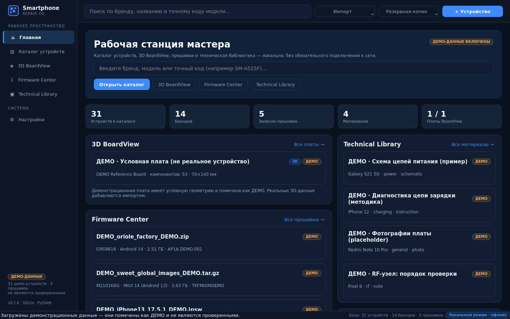
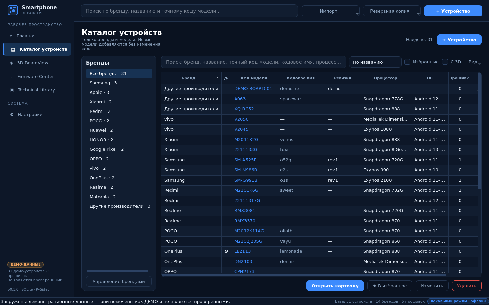
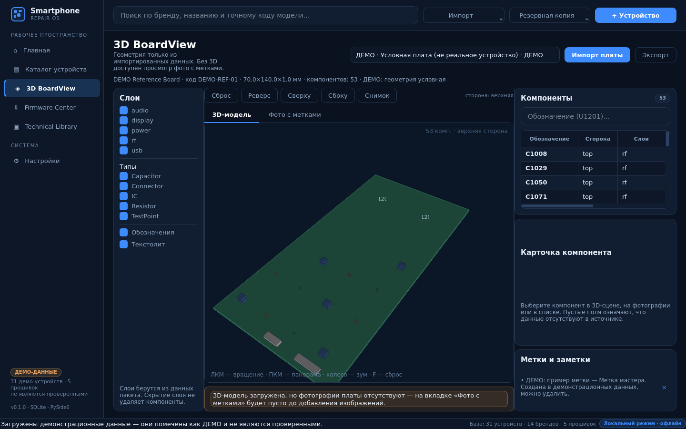
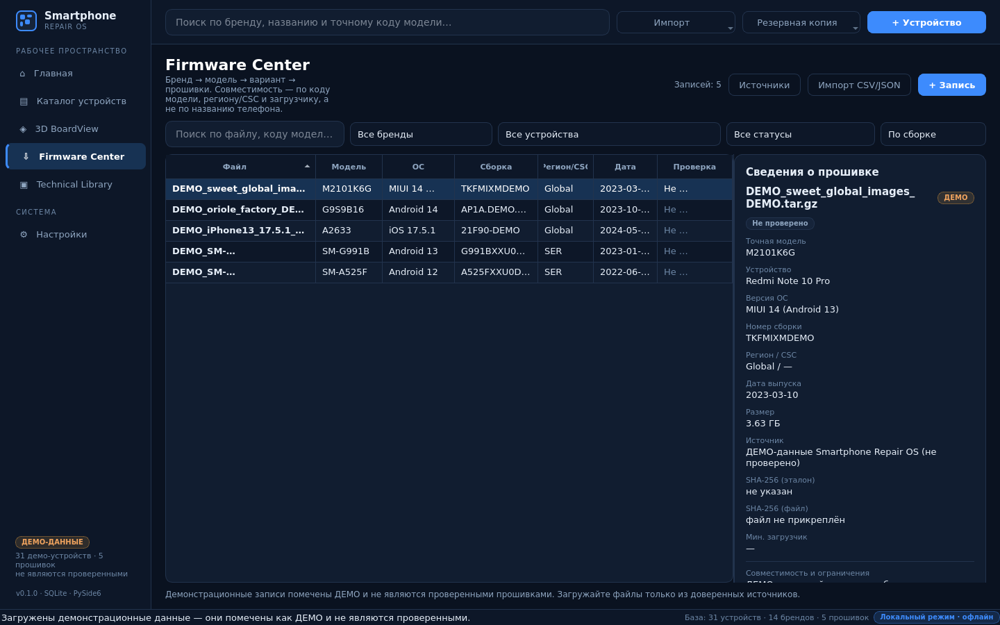
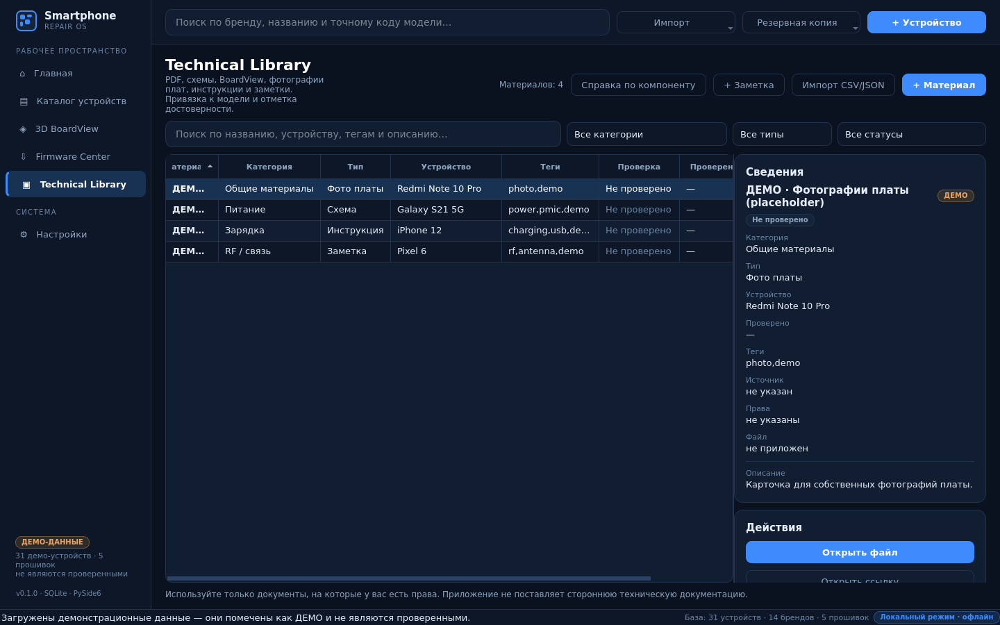

# Smartphone Repair OS

**Локальная рабочая станция мастера по ремонту смартфонов**: каталог устройств, настоящий
интерактивный 3D BoardView, Firmware Center, техническая библиотека и заметки — в одном
приложении для Windows 10/11 (запускается также на Linux/macOS из исходников).

> **Статус:** MVP, версия 0.1.0. Все демонстрационные записи помечены **ДЕМО** и не являются
> проверенными прошивками, схемами или 3D-моделями реальных устройств.



---

## Что уже работает

| Модуль | Возможности |
|---|---|
| **Главная** | поиск по бренду/названию/точному коду модели, блоки 3D BoardView, Firmware Center, Technical Library, популярные бренды, избранное, недавно открытые |
| **Каталог устройств** | 14 брендов, таблица и карточки, фильтры (избранные, «с 3D»), сортировки, добавление/редактирование/удаление без правки кода, варианты (регион/CSC/загрузчик) |
| **3D BoardView** | вращение/зум/панорама, обе стороны платы, выбор микросхем, подсветка, позиционные обозначения, слои и типы, карточка компонента, поиск по обозначению, заметки и метки, импорт/экспорт пакетов, честный программный 3D-рендер + режим фото с метками |
| **Firmware Center** | бренд → модель → вариант → прошивки, поиск по файлу/модели/сборке, фильтры и сортировки, статусы проверки, проверка совместимости (код модели, регион/CSC, загрузчик), проверка SHA-256, прикрепление локального файла с подтверждением, история изменений |
| **Technical Library** | PDF/схемы/BoardView/фото/инструкции/заметки, привязка к модели, категории узлов, теги, статусы достоверности и дата проверки, ссылки на источники, права на использование |
| **Данные** | SQLite с миграциями и индексами, импорт CSV/JSON с предварительной проверкой, экспорт, резервное копирование ZIP (манифест + SHA-256) и восстановление со страховочной копией |
| **Безопасность** | валидация ввода, защита от path traversal и zip-бомб, контрольные суммы, подтверждение опасных операций, шифрование токенов внешних сервисов (при наличии `cryptography`) |
| **Прочее** | тёмная тема, русский интерфейс (каталоги переводов для других языков), логирование с ротацией, 73 автотеста, сборка EXE + установщик через GitHub Actions |

### Скриншоты

| Каталог устройств | 3D BoardView |
|---|---|
|  |  |

| Firmware Center | Technical Library |
|---|---|
|  |  |

---

## Быстрый старт (Windows)

```powershell
git clone https://github.com/Klavish777/test.git
cd test
run.bat
```

`run.bat` создаёт `.venv`, ставит зависимости и запускает приложение. Первый запуск
создаёт базу в `%LOCALAPPDATA%\SmartphoneRepairOS` и загружает демонстрационные данные.

Запуск из исходников вручную:

```powershell
python -m venv .venv
.venv\Scripts\activate
pip install -r requirements.txt
python main.py
```

Linux/macOS: `./run.sh` (нужны системные библиотеки Qt: `libgl1`, `libegl1`,
`libxkbcommon-x11-0`, `libdbus-1-3`, `libxcb-cursor0`).

### Параметры запуска

```text
python main.py                     # обычный запуск
python main.py --no-demo           # пустая база без демо-данных
python main.py --reset-demo        # перезалить демо-данные
python main.py --data-dir D:\RepairOS   # свой каталог данных
python main.py --language en       # язык на этот запуск
python main.py --check             # проверка базы, код возврата 0/1
python main.py --screenshot DIR    # снимки страниц в PNG (для документации)
```

---

## Установка и скачивание

- **Готовый установщик** — раздел [Releases](https://github.com/Klavish777/test/releases)
  (`SmartphoneRepairOS-<версия>-setup.exe`).
- **Портативная сборка** — артефакт `SmartphoneRepairOS-portable` в
  [Actions](https://github.com/Klavish777/test/actions) (сборка Windows).

Подробно: [docs/BUILD_WINDOWS.md](docs/BUILD_WINDOWS.md).

---

## Структура проекта

```text
.
├── main.py                      # точка входа
├── run.bat / run.sh             # скрипты запуска
├── requirements.txt             # зависимости
├── requirements-dev.txt         # зависимости для тестов и сборки
├── pyproject.toml
├── repair_os/
│   ├── app.py                   # CLI, запуск QApplication, режим --check
│   ├── version.py
│   ├── core/                    # независимые от Qt и SQL утилиты
│   │   ├── paths.py             # каталоги данных (LOCALAPPDATA и др.)
│   │   ├── errors.py            # доменные исключения
│   │   ├── logging_setup.py     # логи с ротацией + hook исключений
│   │   ├── i18n.py              # каталоги переводов JSON
│   │   ├── security.py          # SHA-256, безопасная распаковка, валидация URL
│   │   ├── secrets_store.py     # шифрованное хранилище токенов
│   │   └── entitlements.py      # заготовка лицензирования (в MVP всё доступно)
│   ├── data/
│   │   ├── database.py          # подключение, миграции, backup/restore
│   │   ├── migrations/          # 001_initial.sql, 002_board_geometry.sql
│   │   ├── models.py            # доменные модели + валидация
│   │   └── repositories/        # brands, devices, firmware, boards, library, settings
│   ├── services/
│   │   ├── context.py           # единая точка доступа к сервисам
│   │   ├── search.py            # сквозной поиск
│   │   ├── import_export.py     # CSV/JSON импорт/экспорт, шаблоны
│   │   ├── board_packages.py    # формат пакетов BoardView, импорт/экспорт
│   │   ├── firmware_tools.py    # проверка файлов, SHA-256, совместимость
│   │   └── backup.py            # резервные копии ZIP + восстановление
│   ├── seed/                    # демонстрационные данные (is_demo = 1)
│   ├── boardview/
│   │   ├── scene.py             # камера, геометрия, проекция (без Qt)
│   │   ├── viewer_3d.py         # интерактивный 3D-виджет
│   │   └── photo_view.py        # фото платы с метками
│   ├── ui/
│   │   ├── main_window.py       # навигация, строка поиска, статус-бар
│   │   ├── theme.py             # тёмная тема QSS
│   │   ├── widgets.py           # карточки, чипы, бейджи, FlowLayout
│   │   ├── table_models.py      # модели таблиц Qt
│   │   ├── pages/               # home, catalog, device_detail, boardview, firmware, library, settings, search
│   │   └── dialogs/             # редакторы, импорт, резервные копии
│   ├── resources/i18n/          # ru.json, en.json
│   └── data/migrations/         # SQL-миграции
├── tests/                       # pytest: БД, безопасность, репозитории, сервисы, UI
├── docs/                        # документация и скриншоты
├── build/                       # PyInstaller spec + Inno Setup script
├── scripts/                     # сборка Windows (ps1/bat)
└── .github/workflows/ci.yml     # тесты + сборка EXE/установщика + Release
```

---

## Документация

| Документ | О чём |
|---|---|
| [docs/ADDING_DATA.md](docs/ADDING_DATA.md) | как добавлять бренды, устройства, прошивки, материалы и 3D-модели |
| [docs/BOARDVIEW_FORMAT.md](docs/BOARDVIEW_FORMAT.md) | формат пакета платы, координаты, метки, ограничения |
| [docs/ARCHITECTURE.md](docs/ARCHITECTURE.md) | слои, схема БД, миграции, расширяемость, монетизация |
| [docs/USER_GUIDE.md](docs/USER_GUIDE.md) | работа мастера: поиск, 3D, прошивки, библиотека, копии |
| [docs/BUILD_WINDOWS.md](docs/BUILD_WINDOWS.md) | сборка EXE и установщика |

---

## Тесты

```bash
python -m pytest tests -q          # 73 теста
QT_QPA_PLATFORM=offscreen python -m pytest tests -q   # без экрана
```

Покрыто: миграции и ограничения SQLite, backup/restore (включая повреждённые копии),
валидация ввода, защита от zip-атаок, импорт CSV/JSON (dry-run и запись), проверка
совместимости прошивок, SHA-256, импорт/экспорт пакетов BoardView, математика камеры и
построение сцены, smoke-тесты интерфейса (навигация, выбор компонента, слои, фильтры).

---

## Важные ограничения MVP

- **Демо-данные не являются проверенными.** Модели, прошивки, материалы и плата помечены
  `ДЕМО`; ссылки ведут на `example.org`. Их можно удалить: *Настройки → Удалить демо-данные*.
- **Приложение не выдумывает данные.** Нет 3D-модели — показывается фоторежим с явным
  предупреждением; нет назначения компонента — поле остаётся пустым.
- **Приложение не загружает прошивки из интернета** и не обходит защиту устройств.
  Все операции с файлами выполняются только после явного подтверждения.
- **3D-рендер программный** (QPainter, painter's algorithm). Это осознанный выбор:
  нет зависимости от GPU/драйверов и WebEngine, работает по RDP и в виртуалках.
- Нет аккаунта, синхронизации и оплаты — архитектура к ним подготовлена
  (`core/entitlements.py`), но в MVP ничего не блокируется.
- Форматы внешних BoardView (`.brd`, `.bdv`, `.pcb`) требуют конвертации в JSON-пакет.
