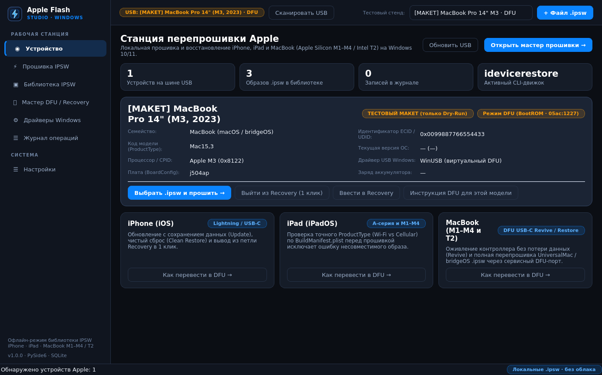
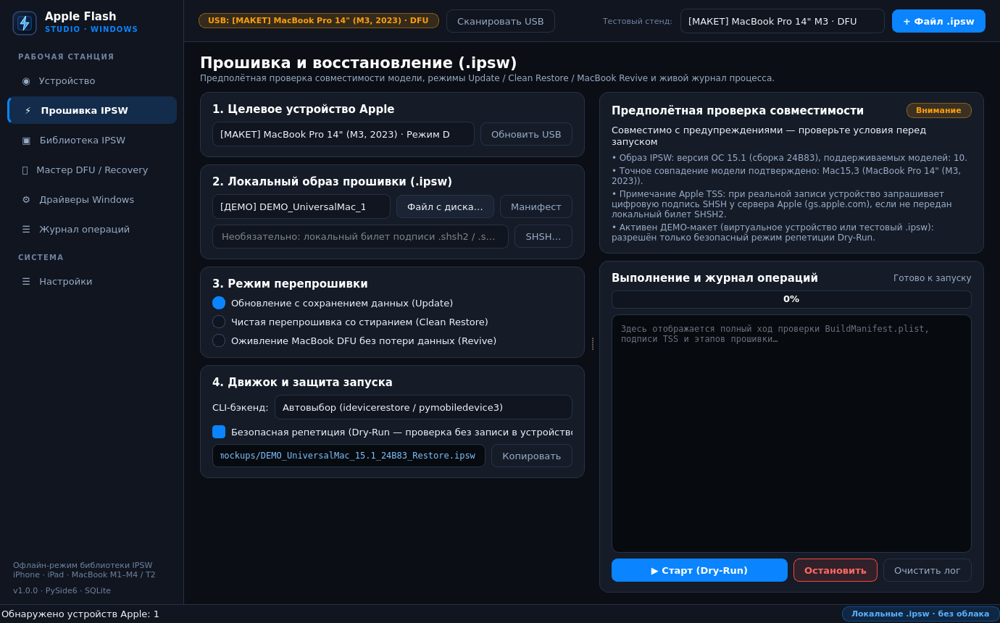
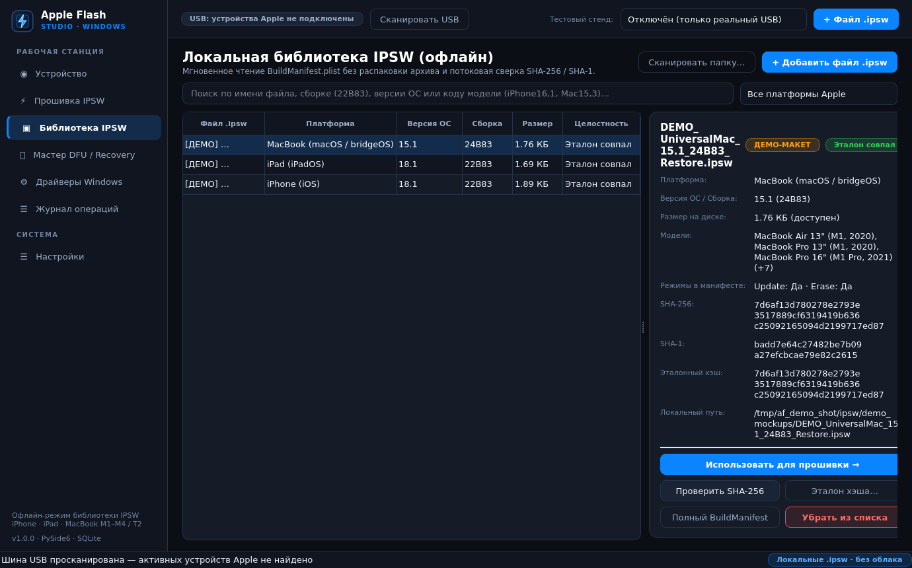
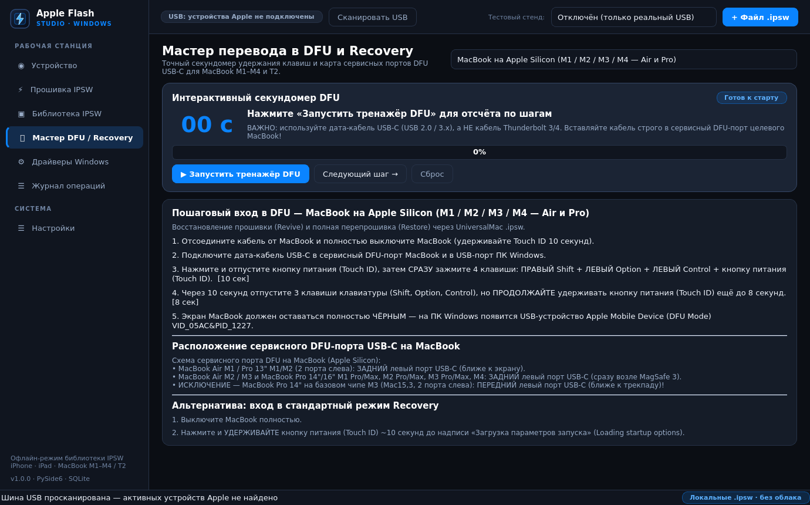
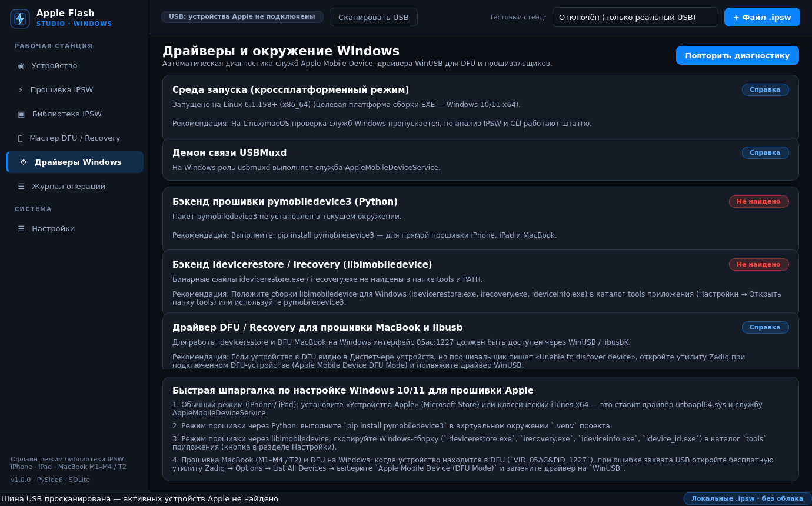

# Apple Flash Studio — перепрошивка и восстановление iPhone, iPad и MacBook на Windows 10/11

**Apple Flash Studio** — самостоятельное настольное приложение для Windows 10/11 (x64) на базе
Python 3.10+ и PySide6, предназначенное для локальной работы с образами прошивок `.ipsw`,
проверки совместимости оборудования, управления режимами Recovery/DFU и перепрошивки
устройств **iPhone**, **iPad** и **MacBook** (Apple Silicon M1–M4 и Intel T2).



---

## Основные возможности

1. **Автоопределение устройств Apple по USB (Normal / Recovery / DFU / WTF)**
   - Поддержка `libimobiledevice` (`idevice_id`, `ideviceinfo`, `irecovery`), `pymobiledevice3`
     и нативного системного сканера Windows PnP (`VID_05AC&PID_1227`, `PID_1281`, `PID_1901`).
   - Автоматическое извлечение `CPID` (идентификатора кристалла Apple A11–A18 / M1–M4 / T2),
     `BDID` и `ECID` прямо из строки USB-устройства Windows даже в «чёрном экране» DFU.
   - Выход из петли `Recovery` (`irecovery -n` / `pymobiledevice3 restore exit-recovery`) и перевод
     в `Recovery` в 1 клик.

2. **Локальная офлайн-библиотека образов `.ipsw`**
   - Строго локальная работа с уже скачанными файлами `.ipsw` без облака и телеметрии.
   - Мгновенное чтение `BuildManifest.plist` и `Restore.plist` (XML и бинарный формат Apple)
     напрямую из ZIP-каталога **без распаковки многогигабайтного архива на диск**.
   - Проверка наличия всех компонентов манифеста (`iBSS`, `iBEC`, `SEP`, `Baseband`, `OS`).
   - Фоновый потоковый расчёт контрольных сумм **SHA-256** и **SHA-1** с индикатором прогресса
     и сверкой с эталонным хэшем.

3. **Мастер перепрошивки и восстановления (Flash & Restore Studio)**
   - **Update (Обновление с сохранением данных)** — обновление iOS / iPadOS / macOS без удаления
     пользовательских разделов.
   - **Clean Restore (Чистая перепрошивка со стиранием)** — полный заводской сброс NAND/SSD
     (защищён диалогом подтверждения с вводом слова `СТЕРЕТЬ`).
   - **Revive MacBook (Оживление Mac в DFU)** — перезапись системной прошивки контроллера
     Apple Silicon (M1/M2/M3/M4) или сопроцессора безопасности Apple T2 (`bridgeOS`) без стирания
     пользовательского тома APFS.
   - **Dry-Run (Безопасная репетиция)** — полная предполётная проверка архива, совместимости
     `ProductType` / `CPID` и генерация точной команды CLI без записи в устройство.
   - Опциональная передача локального билета подписи `.shsh2` / `.shsh` (`idevicerestore -T`).

4. **Интерактивный тренажёр DFU / Recovery с секундомером**
   - Пошаговый таймер удержания кнопок для всех поколений iPhone (Face ID, SE 2/3, 8),
     iPad (с кнопкой Home и без кнопки Home) и MacBook.
   - Встроенная **карта сервисных DFU-портов USB-C** для всех моделей MacBook Air и MacBook Pro
     (включая исключение для MacBook Pro 14" на базовом чипе M3 `Mac15,3`).

5. **Диагностика драйверов Windows и журнал операций**
   - Проверка службы `AppleMobileDeviceService`, модуля `pymobiledevice3`, бинарных утилит
     `idevicerestore.exe` / `irecovery.exe` и рекомендации по привязке `WinUSB` (через Zadig)
     для работы с DFU на Windows.
   - Полный SQLite-журнал всех запусков с экспортом текстовых отчётов `.txt`.

---

## Скриншоты интерфейса

| Мастер прошивки (.ipsw) | Локальная библиотека IPSW |
|---|---|
|  |  |

| Тренажёр DFU и карта портов MacBook | Диагностика драйверов Windows |
|---|---|
|  |  |

---

## Быстрый запуск на Windows 10/11

### Вариант 1. Запуск в один клик из исходников

```powershell
run_apple_flash.bat
```

Скрипт автоматически создаёт виртуальное окружение `.venv`, устанавливает `PySide6` и
`pymobiledevice3`, после чего открывает графическое окно **Apple Flash Studio**.

### Вариант 2. Сборка готового `AppleFlashStudio.exe` и установщика Windows

```powershell
scripts\build_apple_flash_windows.bat
```

Или через PowerShell с указанием версии:

```powershell
powershell -ExecutionPolicy Bypass -File scripts\build_apple_flash_windows.ps1 -Version 1.0.0
```

После завершения сборки:
- Портативная версия: `dist\AppleFlashStudio\AppleFlashStudio.exe`
- Установщик Windows (если установлен Inno Setup 6): `installer\Output\AppleFlashStudio-1.0.0-setup.exe`

---

## Подготовка драйверов и прошивальщиков на Windows

1. **Обычный режим связи (Normal Mode / USBMux)**:
   - Установите официальное приложение **«Устройства Apple» (Apple Devices)** из Microsoft Store
     или классический пакет **iTunes x64** с сайта Apple. Это установит драйвер `usbaapl64.sys`
     и запустит системную службу `AppleMobileDeviceService`.
2. **Движок перепрошивки (достаточно одного из двух)**:
   - **pymobiledevice3** (устанавливается автоматически через `run_apple_flash.bat` или командой
     `.venv\Scripts\pip install pymobiledevice3`), либо
   - **libimobiledevice / idevicerestore для Windows**: скопируйте файлы `idevicerestore.exe`,
     `irecovery.exe`, `ideviceinfo.exe`, `idevice_id.exe`, `ideviceenterrecovery.exe` в папку
     `%LOCALAPPDATA%\AppleFlashStudio\tools` (кнопка **«Открыть папку tools»** на вкладке *Настройки*).
3. **Особенность режима DFU на Windows (особенно для MacBook M1–M4 / T2 и `idevicerestore`)**:
   - Подключите устройство в режиме DFU (экран полностью чёрный, в Диспетчере устройств видно
     `Apple Mobile Device (DFU Mode)` с кодом `USB\VID_05AC&PID_1227`).
   - Для кабеля MacBook используйте дата-кабель **USB-C (USB 2.0 / 3.x)** (не кабель Thunderbolt!)
     строго в сервисный DFU-порт целевого ноутбука (см. вкладку *Мастер DFU / Recovery*).
   - Если `idevicerestore` не может захватить USB-интерфейс DFU из-за стандартного драйвера,
     откройте бесплатную утилиту **Zadig** → *Options → List All Devices* → выберите
     `Apple Mobile Device (DFU Mode)` и нажмите **Replace Driver → WinUSB**.

---

## Важные технические и правовые ограничения

- **Подпись прошивок Apple TSS**: при реальной перепрошивке iPhone, iPad и MacBook загрузчик
  запрашивает цифровую подпись компонентов (`SHSH2` / `ApTicket`) у официального сервера Apple
  (`gs.apple.com`), если не передан заранее сохранённый билет подписи. Установить неподписываемую
  компанией Apple версию iOS/iPadOS в штатном режиме нельзя.
- **Никакого обхода защиты владельца**: приложение **не обходит** блокировку активации iCloud
  (Activation Lock / Find My), MDM-профили или код-пароль устройства. Если на устройстве включён
  «Локатор», после чистой перепрошивки потребуется ввод Apple ID владельца.
- **Учебные ДЕМО-макеты**: создаваемые при первом запуске файлы `DEMO_*.ipsw` содержат только
  структуру `BuildManifest.plist` для проверки интерфейса и режима `Dry-Run`. Реальная запись
  демо-макетов на устройство программно заблокирована; удалить их можно в один клик в разделе *Настройки*.
